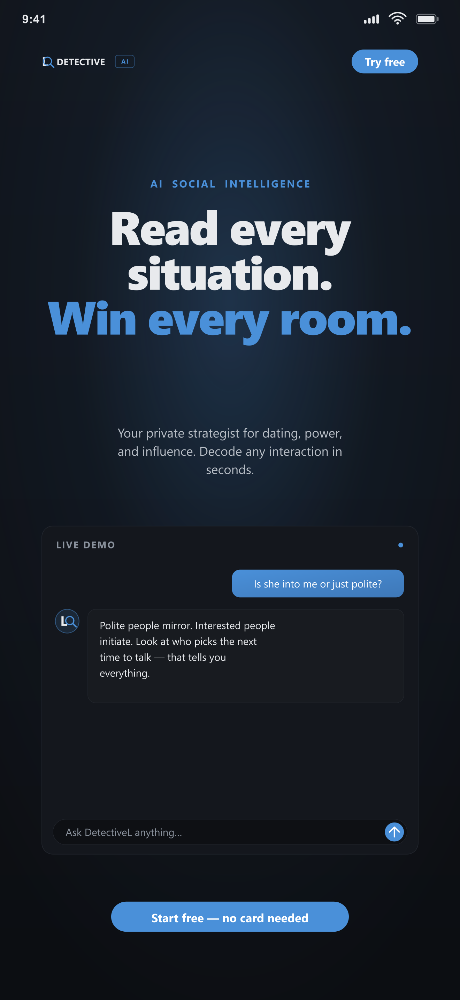
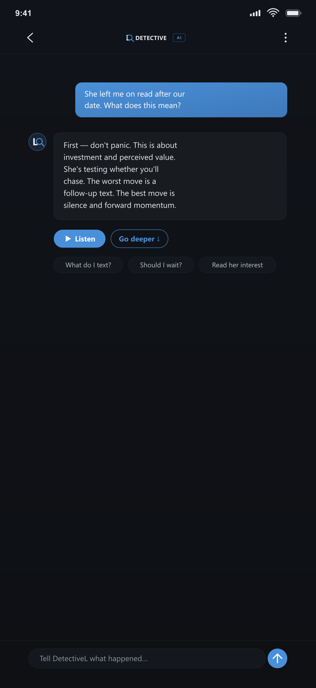
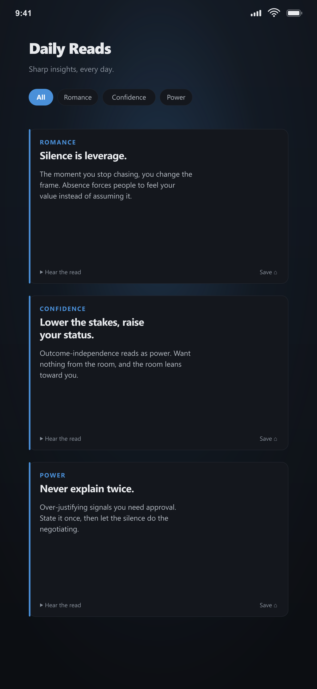
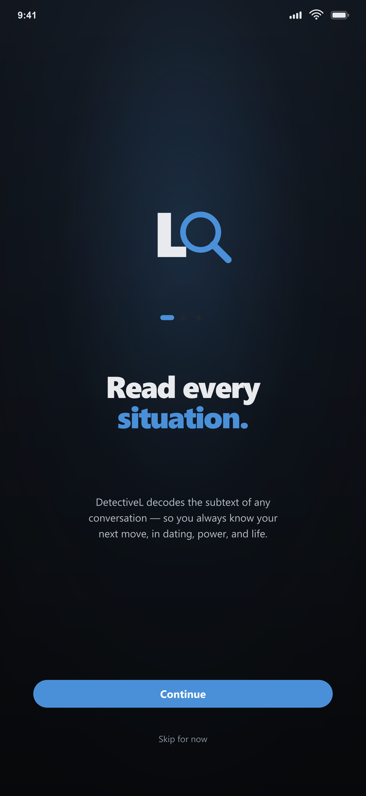
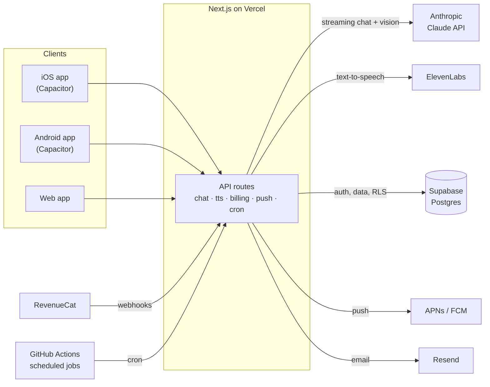

# Detective L AI

**An AI social-intelligence advisor: describe any social situation – a date, a group chat, a negotiation, a tense moment at work – and Detective L tells you what's really going on and exactly what to do or say next.**

  
  

**Live on the web:** https://detective-l-ai.vercel.app

> Source code is private - this is a production commercial app. Happy to walk through it in an interview.

<table>
  <tr>
    <td></td>
    <td></td>
    <td></td>
    <td></td>
  </tr>
</table>

## Key features

- **Instant situation reads** – streamed, chat-style answers that explain the subtext and give a concrete next move, with one-tap follow-ups ("What do I text?", "Should I wait?").
- **Screenshot analysis** – attach a screenshot of a conversation (including a one-tap "the screenshot you just took" shortcut on iOS and Android) and get a read on it.
- **Voice replies** – listen to any answer with natural text-to-speech.
- **Daily Reads** – short daily insights by category (romance, confidence, power), each with audio.
- **Personalization** – onboarding and a "directness" setting from gentle to brutally honest.
- **English and Hebrew**, sign in with Apple / Google / email, and full account deletion from inside the app.

## Tech stack

| Area | Technology |
|---|---|
| App | Next.js 14 (App Router), React, TypeScript, Tailwind CSS |
| AI | Anthropic Claude API (streaming, vision, prompt caching) |
| Voice | ElevenLabs streaming text-to-speech |
| Backend & data | Next.js API routes on Vercel, Supabase (Postgres, Auth, Row Level Security) |
| Mobile | Capacitor 8 – native iOS and Android apps, plus 4 custom in-house Capacitor plugins (Swift / Kotlin / Java) |
| Payments | RevenueCat subscriptions (App Store + Google Play) with server-side purchase verification and webhooks |
| Notifications & email | Push (APNs / FCM), local notifications, transactional email via Resend |
| Observability | Sentry (client, server and edge) |
| CI/CD | Vercel (500+ production deployments), GitHub Actions scheduled jobs, Codemagic iOS builds |

## Architecture

The native apps load the production web app inside a Capacitor shell, so one Next.js codebase serves iOS, Android and the web. All provider keys (Anthropic, ElevenLabs, Supabase service role, payments) live only in server-side API routes – nothing secret ships to the client.

## Engineering highlights

- **One codebase, three platforms.** A single Next.js app ships to the App Store, Google Play and the web via Capacitor. iOS builds are fully automated on Codemagic: the iOS project is regenerated in CI, signed through the App Store Connect API, and uploaded without manual Xcode steps.
- **Custom native plugins.** Four in-house Capacitor plugins written in Swift and Kotlin/Java: a screenshot picker (iOS PhotoKit / Android MediaStore), Android streaming haptics using composition primitives, and native bridges for Meta and TikTok attribution SDKs.
- **Streaming AI with cost control.** Claude responses stream token by token with matching haptic feedback. A scheduled GitHub Actions job keeps Claude's prompt cache warm, so users arriving during quiet periods don't pay a cache miss (several seconds of first-token latency and double input cost).
- **Voice.** ElevenLabs streaming TTS for answers and Daily Reads.
- **Notifications.** Native push on iOS and Android with a server-side dispatcher (hourly GitHub Actions job), daily caps, retries and reminder scheduling, plus local notifications.
- **Billing.** Subscriptions and free trials through RevenueCat, with server-side Google Play purchase verification and webhook-driven entitlement sync to Supabase.
- **Production hygiene.** Sentry monitoring, Supabase Row Level Security, account deletion, consent handling and attribution, EN/HE localization.
- **Scale of the work.** 550+ commits and 500+ production deployments since May 2026; rated 4.5★ on the App Store.

## My role

Co-founded Detective L AI with a business partner. I build and ship the product end to end: the Next.js app and API, the AI and voice integrations, the Supabase backend, the native iOS and Android apps with their custom Capacitor plugins, billing and notifications, and the CI/CD pipelines that release to the App Store, Google Play and the web.
